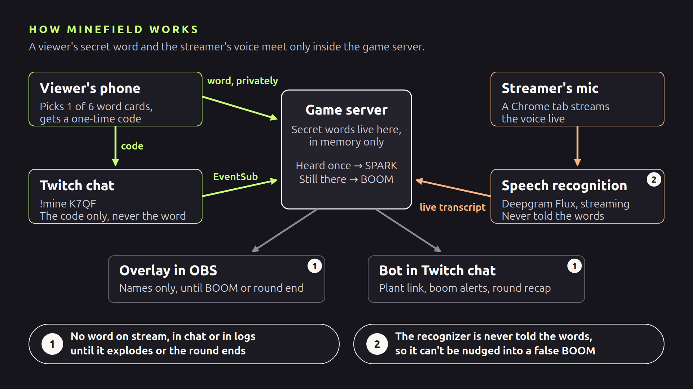

# Minefield

**Your chat sets the trap. Your voice springs it.**

Viewers secretly plant words from their phones, and the streamer never sees them. When the streamer says one live, speech recognition blows up the overlay, names the viewer who planted it and gives them a point. Built solo in four days with Codex for the Codex x TwitchCon Hackathon.

- [Watch the 3-minute video](https://youtu.be/bpzYgdAO35I)
- [Watch the full round on Twitch](https://www.twitch.tv/videos/2915722545)



## Try it in 2 minutes (no keys)

This works from a fresh clone with no `.env`, Twitch account, Deepgram key or cloudflared. You need Linux or WSL (the launcher uses `setsid`) with Bash 4.4+, Python 3.12 and [uv](https://docs.astral.sh/uv/getting-started/installation/).

1. Start demo mode:

   ```bash
   ./scripts/run_all.sh --demo
   ```

2. Open the dock at `http://localhost:8100/dock` and the overlay at `http://localhost:8100/overlay`.
3. In a second terminal, start a round and plant a word as a viewer (or press Start round in the dock and run only the second command):

   ```bash
   curl -fsS -X POST http://localhost:8100/dock/round/start
   curl -fsS -X POST http://localhost:8100/dock/debug/plant \
     -H 'Content-Type: application/json' \
     -d '{"owner":"demo-viewer","word":"pineapple"}'
   ```

4. Wait 30 seconds for the mine to arm (the dock counts it down), then type `I could go for some pineapple` in the dock's typed box and send it. Click the overlay page once beforehand so the browser allows the boom sound.

The overlay explodes, and the banner names `demo-viewer` and shows the sentence with `pineapple` highlighted. Press False alarm in the dock within 10 seconds to take the point back. To see a reveal, plant a second word with the same curl command and `{"owner":"second-viewer","word":"volcano"}`, then end the round from the dock: `volcano` is revealed as a dud.

Demo mode disables Twitch, the speech engine and the tunnel, so all five dock health lights stay red; that is expected. The `?demo=1` link the script prints is a separate scripted preview that needs no game state; the live game is at `/overlay`. With different ports, replace `8100` in the commands.

## How it works

A Python game server (FastAPI) joins two paths:

- **Viewer path.** The plant page reaches phones through a Cloudflare quick tunnel. The server deals each viewer six words and keeps their pick private; chat carries only a one-time code (`!mine AB12`). The bot reads commands through Twitch EventSub and answers through the Helix chat API.
- **Voice path.** A Chrome tab streams the microphone as 16 kHz audio to a speech engine, which streams it to Deepgram Flux. Each partial transcript goes to the matcher. A mine sparks when the recognizer first hears its word and explodes when the next update agrees; if the recognizer changes its mind, it fizzles.

Two rules keep it fair: no mine word reaches the overlay, the dock, chat, the game's INFO logs or any Twitch API call until it explodes or the round ends, and the recognizer is never told the words (no keyword boosting). Every connection reconnects on its own and resyncs from a snapshot, so a dropped link never stops the round. [SPEC.md](SPEC.md) defines the rules, messages and architecture.

## How it was built with Codex

[SPEC.md](SPEC.md) was the contract: it split the game into 13 work packages with acceptance criteria, and [AGENTS.md](AGENTS.md) held the rules (secrecy, no recognition biasing, a pure core). Most of the work ran in one main Codex thread, session `01a188b5-edca-79f3-9ee7-1b1d7198d173`, with side threads building the overlay and the phone planting page in parallel, and parallel subagents on bigger milestones.

- **Tests first.** For each work package, Codex wrote the tests before the code. 223 offline tests run by default; 66 live Twitch, Deepgram and browser tests run separately.
- **Official docs.** Codex checked every Twitch and Deepgram call against the official documentation and left the source links in the code.
- **Self-checks.** It took headless screenshots of its own overlay and fixed what it could not read.
- **Review.** The Twitch milestone went through [pull request #1](https://github.com/furkankuscu08/twitch/pull/1), reviewed with `@codex review`.
- **Rehearsal logs.** A saved rehearsal log showed the transcript falling 2.5 minutes behind the mic; Codex traced it to short audio gaps that added up and fixed it with a regression test (commit `99323e9`).

Codex was the main builder; other coding agents helped now and then.

## Play on Twitch (full setup)

Run the Python services on Linux or WSL. Open the microphone page in Chrome; with WSL, use **Chrome on Windows**, where microphone access works reliably. You need Bash 4.4+, Python 3.12, [uv](https://docs.astral.sh/uv/getting-started/installation/), and [cloudflared](https://developers.cloudflare.com/cloudflare-one/networks/connectors/cloudflare-tunnel/downloads/) on `PATH`. No GPU, local speech model, Node.js or frontend build is required.

```bash
uv sync --locked
```

Create a local `.env` in the checkout. Fill in values privately; never commit it, credentials, or anything under `data/`.

```dotenv
DEEPGRAM_API_KEY=
# Optional (defaults shown)
DEEPGRAM_REGION=eu
STT_BACKEND=flux
TWITCH_CLIENT_ID=
TWITCH_BROADCASTER_LOGIN=
TWITCH_BOT_LOGIN=
# Optional: test viewers for live checks and rehearsals
TWITCH_TEST_LOGIN=
TWITCH_TEST2_LOGIN=
TWITCH_TEST3_LOGIN=
```

Create an API key in the [Deepgram console](https://console.deepgram.com/) using its [key setup guide](https://developers.deepgram.com/guides/fundamentals/make-your-first-api-request). The default backend is Flux, with Nova-3 as a backup using the same key. Speech goes to the EU endpoint by default. Deck words are never sent as recognition hints.

### Twitch authorization

Register the app in the broadcaster's [Twitch developer console](https://dev.twitch.tv/console/apps), following [app registration](https://dev.twitch.tv/docs/authentication/register-app/). Set its client type to **Public** and put its Client ID in `TWITCH_CLIENT_ID`. If registration requires an OAuth redirect URL, `http://localhost:3000` is sufficient; device-code login does not use that callback. Minefield needs no client secret.

Set `TWITCH_BROADCASTER_LOGIN` to the channel owner and `TWITCH_BOT_LOGIN` to the bot account. Make the bot a moderator in the channel, then authorize it:

```bash
uv run python -m minefield.twitch_api.auth --account bot
```

Open the printed activation URL, verify that the browser is signed into the bot account, and approve the code. The CLI validates the identity and saves rotating token pairs in `data/tokens.json`. The bot requests `user:read:chat` and `user:write:chat`. No broadcaster token is required. The [Public client device-code flow](https://dev.twitch.tv/docs/authentication/getting-tokens-oauth/#device-code-grant-flow) was verified on 30 October 2026. Never paste tokens into chat, screenshots or bug reports.

For automated live checks, also set `TWITCH_TEST_LOGIN` to a separate test viewer and authorize it with `--account test`; it requests only `user:write:chat`.

### Start a game

```bash
./scripts/run_all.sh
```

The script installs locked dependencies, checks configuration, starts the game/plant listeners and the microphone engine, and asks the server to manage its quick tunnel. There is only one cloudflared process. A missing Deepgram key fails clearly before services start. Twitch connects when its configuration and saved bot token exist.

Open these URLs using the configured game port:

| Page | Default URL | Use |
| --- | --- | --- |
| Mic | `http://localhost:8100/mic` | Chrome: allow mic access, select the device and start capture |
| Dock | `http://localhost:8100/dock` | OBS custom browser dock, about 400 px wide |
| Overlay | `http://localhost:8100/overlay` | OBS browser source, 1920×1080 with transparent background |
| Local plant | `http://localhost:8101/` | Local inspection only; viewers use the public tunnel URL |

In OBS, enable **Control audio via OBS** for the overlay source and route/monitor it as needed. The synthesized boom targets a peak near −1 dBFS; balance the source against speech in the OBS mixer. If a normal browser blocks sound, interact with the page to allow audio. Add `?latency=1` to the overlay URL for the small debug latency badge.

Wait for the dock's connection lights, start a round and share the current plant URL/QR. A viewer sends `!mine`, opens the link, picks a card and sends the displayed `!mine CODE` in Twitch chat. Mines arm after 30 seconds. Each boom earns its viewer one session point; a false alarm retracts that point and duds earn nothing. TOP TRAPPERS shows the top three viewers. Scores survive round changes and reset when the server stops. The streamer does not score. A moderator can use `!defuse`, or the streamer can use the dock's False alarm button, within 10 seconds of a mistaken boom.

The public [quick tunnel](https://developers.cloudflare.com/tunnel/get-started/quick-tunnels/) exposes only the plant app. Its URL changes after a tunnel restart; the overlay QR and `!mine` reply update automatically. Stop the script with **Ctrl+C** to shut down the engine, both listeners and the tunnel. A service exiting also stops the other service. Restarting loses the current round and session scores.

Override ports in `.env` or exported environment variables; exported values take precedence:

```bash
GAME_PORT=8200 PLANT_PORT=8201 STT_MIC_PORT=8265 ./scripts/run_all.sh
```

If Flux performs badly, stop the launcher and restart with `STT_BACKEND=nova3`. If Deepgram is unreachable, use the dock's typed mode deliberately; there is no automatic fallback.

## Checks

```bash
uv run pytest                         # offline tests; no browser or credentials
uv run ruff check .
uv run ruff format --check .
uv run playwright install chromium    # once; no --with-deps
uv run pytest -m browser              # explicit Chromium checks
uv run pytest -m live --tb=short      # real Twitch/Deepgram; bot + test tokens and key
uv run python scripts/shoot.py overlay # every scripted step, no running server needed
```

Screenshots go to ignored `data/shots/`. Overlay shots include transparent PNGs, synthetic webcam previews, both galleries and a shrink midpoint. The webcam scene is generated only by the screenshot script; the actual overlay remains transparent. The same screenshot command accepts `dock`, `plant` or `mic` when the server is running; it honors `GAME_PORT` and `PLANT_PORT`.

For the scripted visual demo, open `http://localhost:8100/overlay?demo=1`. It needs no game state, WebSocket, API key or engine; `&step=N` freezes a numbered step silently. Use steps 6 (full banner), 7 (compact), 8 (false alarm), and 12 (reveal) for frozen views.

## Operations: rehearsal and recording

These steps were used to rehearse and record the demo; normal play does not need them. See also the [demo-day checklist](docs/demo-day.md).

**Extra viewers.** For blind planting, set `TWITCH_TEST_LOGIN`, `TWITCH_TEST2_LOGIN` and `TWITCH_TEST3_LOGIN` to three viewer accounts and authorize them with `--account test`, `--account test2` and `--account test3`. Use your own incognito Chrome window for viewer activation, checking the account before approving each code; do not use a browser signed in as the broadcaster. All three viewers request only `user:write:chat` and have separate entries in the same token file.

Before each rehearsal and recording, with the server stopped, refresh all three viewer tokens. A failed refresh prints the exact device-login command needed to authorize that account again.

```bash
for account in test test2 test3; do
  uv run python -m minefield.twitch_api.auth --account "$account" --refresh
done
```

**Blind planting.** After refreshing the tokens, start the normal server and a round. Then run:

```bash
uv run python -m scripts.blind_plant
```

The helper attempts one mine per viewer over an independently random 0–60 second delay, using the local plant API and real viewer chat messages. A single dock WebSocket confirms each owner. Output shows only owners and success/failure; a credential warning includes that account's exact refresh command. The helper never reveals choices, writes words or automatically replants. A failed account does not block the others. Existing one-live-mine-per-viewer and four-live-mine limits still apply. `BLIND_PLANT_WINDOW_S` overrides the delay window; `BLIND_PLANT_CONFIRM_TIMEOUT_S` overrides the 10-second confirmation timeout. Leave the round running during recording; ending it reveals survivors as usual.

**Private logs.** For rehearsal or recording, enable both logs with a new timestamp:

```bash
stamp=$(date -u +%Y%m%dT%H%M%SZ)
./scripts/run_all.sh --save-hyps "data/rehearsal-${stamp}-hyps.jsonl" \
  --save-events "data/events/rehearsal-${stamp}-events.jsonl"
```

Use a `recording-` prefix for recording sessions. Hypotheses contain `emitted_wall`; event JSONL contains `received_wall`, `received_utc` and the original event, including the boom’s `at`. Round boundaries are observed transitions; connection-gap markers mean events may be missing. Event files must be new. For raw provider responses, run the engine separately with its `--save-raw` flag. These private logs can contain speech; do not share them publicly. Review the saved hypotheses after rehearsal to diagnose misses/false booms, tune configuration and prune misheard deck words.
